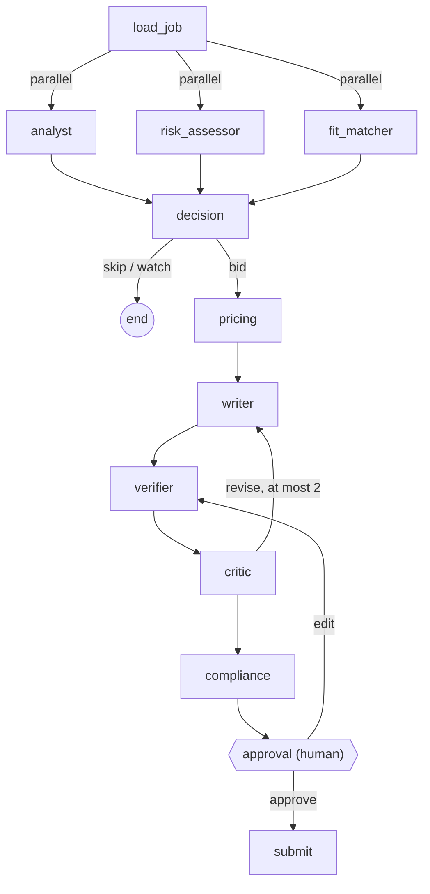

# GigBid

**An AI assistant that reads a freelancer's job feed, skips the scams and the poor fits, and drafts
proposals from evidence in their own portfolio. Then it stops and waits for them to approve.**

[[PENDING: demo GIF (docs/images/demo.gif), 30 seconds: inbox → analysis → draft with evidence → approve]]

| | |
|---|---|
| **Live app** | <https://zoyaahmad-gigbid.hf.space> (Space: [huggingface.co/spaces/zoyaahmad/gigbid](https://huggingface.co/spaces/zoyaahmad/gigbid); free ZeroGPU hardware, so the first visit after a quiet spell takes about a minute to wake it). Reviewer login: [[PENDING: email / password]] (AI/ML persona) |
| **Demo video (3 min)** | [[PENDING: link]] |
| **Write-up** | [[PENDING: link]] |
| **Report** | [`docs/REPORT.pdf`](docs/REPORT.pdf) (R&D design review, 10 pages) |
| **Portfolio MCP server** | `docker run -i --rm -e PORTFOLIO_PERSONA=ai_ml ghcr.io/zoyaahmad428/gigbid:latest python -m mcp_servers.portfolio.server` ([README](mcp_servers/portfolio/README.md)) |

Built for AI-4016 (assignment II). The marketplace is **GigSim**, a simulator of an Upwork-style
platform built from public Kaggle data (`docs/DATA_CARD.md`). Proposals and Connects are simulated,
but the safety rules are the ones a real account would need.

## What it does

1. **Scouts** new jobs on a schedule and shows them in an inbox.
2. **Analyses each job with three agents in parallel:**
   - what the client needs;
   - how risky the post is (scam patterns, client history, instructions planted in the post);
   - which of the freelancer's projects prove each requirement.
3. **Decides** bid, watch or skip, with reasons. A skipped scam costs only its analysis, under
   a tenth of a cent.
4. **Prices** the bid from market statistics, the client's budget and the freelancer's floor.
5. **Drafts** a proposal from retrieved evidence:
   - a verifier removes any claim the portfolio doesn't support;
   - a critic sends weak drafts back, at most twice;
   - a compliance guard checks platform rules.
6. **Stops at an approval card** that shows the draft, the evidence behind every claim, the risk
   report and the price rationale. Nothing is sent, and no Connects are spent, until the
   freelancer approves.
7. **Handles client replies:** drafts an answer and offers interview slots from the calendar,
   with the same approval step.

## Architecture



- **Graphs.** Both graphs are LangGraph, rendered from code in
  [`docs/images/bid_graph.mmd`](docs/images/bid_graph.mmd) and
  [`conversation_graph.mmd`](docs/images/conversation_graph.mmd). Approvals are `interrupt`s, and
  every step is checkpointed (Postgres in the Docker stack, SQLite in the single-container
  demo), so a pending approval survives a restart.
- **Tools.** Every tool sits behind one of three MCP servers we wrote:
  - **Portfolio**, read-only evidence search;
  - **Marketplace**, GigSim behind a port that a live Upwork adapter can fill;
  - **Workspace**, calendar and email drafts.

  Each agent has an allowlist of tools.
- **Stack.** API in FastAPI, web app in React + TypeScript (Vite), background runs on an Arq
  worker with Redis. Traces are kept per thread, with tokens and cost per node (Langfuse
  optional).
- **More:** [`docs/ARCHITECTURE.md`](docs/ARCHITECTURE.md), [`docs/TOOLS.md`](docs/TOOLS.md),
  [`docs/RUNBOOK.md`](docs/RUNBOOK.md).

## Results

All numbers come from `evals/results/` (tables in
[`evals/results/RESULTS.md`](evals/results/RESULTS.md); method and limits in
[`docs/EVALUATION.md`](docs/EVALUATION.md)). Evaluations ran on a free API tier (200k tokens per
model per day), so samples are small and reported as counts.

**Retrieval and proposals** (V0 baseline vs the shipped retriever; retrieval over 285 dev bid jobs,
proposals on 12; `evals/results/summary.json`, `proposal_quality`):

| | Recall@5 | nDCG@10 | Unsupported claims / proposal (first draft → after verification) | Judge (1–5) | GigSim reply rate | p95 latency | Cost / proposal |
|---|---|---|---|---|---|---|---|
| V0: dense, whole post as query | 0.366 | 0.463 | 0.33 → 0.17 | 3.42 | 2/12 | 23.6 s | $0.0007 |
| **Shipped:** decomposition + hybrid + outcome transfer + multi-vector | **0.588** | **0.670** | **0.17 → 0.00** | 3.42 | 1/12 | 22.9 s | $0.0006 |

Better retrieval halved unsupported claims but didn't raise replies. With 12 pairs that's noise
(McNemar p = 1.0). Also, the simulated client counts numbers in a letter without checking them
(report, section 4).

**The judge was checked against my own labels on 30 drafts.** The first judge prompt agreed
poorly (quadratic kappa 0.29). It also *obeyed* instructions planted in job posts: it marked letters
down for not starting with "BANANA". The second prompt treats the post as untrusted, and agreement
rose to 0.61. That prompt was written after seeing the disagreements, so 0.61 is optimistic
(`judge_calibration.json`; report, section 4).

**Single agent vs prebuilt supervisor vs our graph** (same model, same tools):

[[PENDING: C table]]

**Safety:**

- **Planted instructions in job posts:** followed in 7 of 15 jobs with a plain prompt, and in
  **0 of 15** with GigBid's defences (`injection_asr.json`).
- **Scams:** all 6 dev scams skipped.
- **Bid-or-skip on 36 dev jobs:** F1 0.94, after the injection detector stopped counting against the client (0.88 before; report, section 8).
- **Job analysis:** p95 35 s, $0.0006 per job (`summary.json`).

## Traces

- [Scam post skipped before any writing](docs/traces/skipped-scam.md)
- [Approved proposal with a bounded Critic loop](docs/traces/approved-proposal.md)
- [[PENDING: crash and resume]]

## Run it

```bash
cp .env.example .env               # add OPENAI_API_KEY (a Groq key) and the other values
make up                            # Docker: web + API, worker, GigSim, Postgres, Redis, MCP servers
# open http://localhost:8000
```

Without Docker (see [`docs/RUNBOOK.md`](docs/RUNBOOK.md)):

```bash
python -m venv .venv && . .venv/bin/activate
pip install -e ".[dev,evals]"
make gigsim                        # terminal 1: the marketplace simulator on :8081
GIGBID_DB=sqlite make api          # terminal 2: API on :8000
make web-install web               # terminal 3: web app on :5173
```

**Tests and evaluations:**

| Command | What it runs |
|---|---|
| `make test` | unit, contract, integration, GigSim and MCP tests |
| `make web-test` | Playwright browser tests |
| `make gate` | the offline evaluation gate |
| `make eval` | the LLM evaluations (needs a key) |

## Models and versions

Prices are the provider's list prices, as set in `agent/config.yaml`:

| Role | Model (Groq, `open` profile in `agent/config.yaml`) | Price per M tokens in / out |
|---|---|---|
| Analysis, risk, compliance, intent | `openai/gpt-oss-20b` | $0.075 / $0.30 |
| Writer, critic, client replies | `openai/gpt-oss-120b` | $0.15 / $0.60 |
| Fallback | `qwen/qwen3.8-27b` | $0.29 / $0.59 |
| Injection classifier | `meta-llama/llama-prompt-guard-2-86m` | $0.04 |
| Embeddings, reranker (local CPU) | `BAAI/bge-small-en-v1.5`, `jinaai/jina-reranker-v1-turbo-en` | — |

**Pinned versions:**

- **Python:** fastapi 0.162.7, langgraph 1.2.22, langchain-core 1.8.0, mcp 2.3.0, openai 3.51.0,
  fastembed 0.9.1, arq 0.28.0. The rest are pinned in [`pyproject.toml`](pyproject.toml).
- **Web:** React 19, Vite 6, TypeScript 5.8 ([`apps/web/package-lock.json`](apps/web/package-lock.json)).

## Safety rules the code enforces

- **Nothing is sent or spent without a person.** Proposals, messages and Connects spends go
  through an approval `interrupt`. Marketplace writes are dry-run by default and idempotent, so a
  crash can't submit twice.
- **Job posts and client messages are untrusted data.** They are delimited in every prompt
  (`agent/prompts/`) and checked by a regex detector and Prompt Guard before drafting.
- **Every claim about past work must be backed by a portfolio document,** or it is removed.
- **No scraping or browser automation.** Live mode is planned only through Upwork's official
  MCP server with OAuth (`mcp_servers/marketplace/adapters/upwork_live.py`; not built yet).
- **Personal data stays out of logs.** Emails, phone numbers and payment details are masked in
  traces and audit logs.

[`docs/AI_USAGE.md`](docs/AI_USAGE.md) records how an AI coding assistant was used and the
mistakes it made that were caught.
