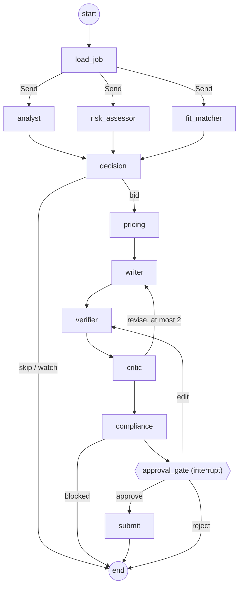

# Architecture

GigBid is a set of agents in two LangGraph graphs. Every capability is an MCP tool behind three
servers we wrote. Everything a client sees passes through a human approval step.

```
Web app (React) ──► API (FastAPI) ──queue──► Arq worker (Redis) ◄── schedules: scout, monitor
                        │  app store: users, run index, run events (the live stream reads these)
                        ▼                         ▼
                   Runtime (agent/runtime.py) ──► bid graph / conversation graph
                        │  checkpoints and long-term memory (Postgres; SQLite in local dev)
                        │  trace store (SQLite) ──► Langfuse (optional)
                        ▼
                   Toolbox (agent/mcp_client.py): per-agent allowlists, timeouts, retries, tracing
                      │                    │                         │
               Portfolio MCP        Marketplace MCP            Workspace MCP
               (read-only)          (port: GigSim | Upwork)    (calendar + drafts)
```

Both graphs are rendered from code in `docs/images/bid_graph.mmd` and
`docs/images/conversation_graph.mmd` (`python -m agent.graphs.render`).

## Bid graph (one thread per job)



| Node | Why it exists | Model | Tools |
|---|---|---|---|
| `load_job` | The Scout hands in a job id; the graph loads it once through MCP | none | `get_job` |
| Job Analyst | Turns a messy post into a `JobSpec`: requirements, skills, budget, hidden needs | gpt-oss-20b | none |
| Risk Assessor | Catches scams, free-work and off-platform asks, and injected instructions; rates the client | gpt-oss-20b, plus rules and Prompt Guard | `get_client_history` |
| Fit Matcher | Maps each requirement to portfolio evidence (deployed retriever: `combined`, see `rag/variants/README.md`); refuses only when no requirement or skill has any support | cross-encoder (CPU) | `search_evidence`, `get_evidence`, `list_skills` |
| Decision | Bid, watch or skip from config: risk limit, fit thresholds (calibrated by `evals/runners/fit_calibration.py`) and your budget floor. Explainable; hard scam flags can't be overridden | none | none |
| Pricing Strategist | Bid from market percentiles, the client's budget and the user's floor; is the Connects cost worth it? | none | `get_market_stats`, `get_connects_balance`, `get_client_history` |
| Proposal Writer | Cover letter and screening answers, every claim cited to evidence | gpt-oss-120b | evidence passed in by the Fit Matcher |
| Verifier | Splits the draft into claims and removes unsupported ones before the Critic sees it | cross-encoder plus number and skill checks | none |
| Critic | Grounding, personalisation, length, clarity; sends the draft back at most twice | gpt-oss-120b plus rules | none |
| Compliance Guard | Policy pack: rules strip contact details, guarantees and injection canaries, then a model checks the rest; can block | gpt-oss-20b plus rules | none |
| Approval gate | `interrupt()` with the draft, claim evidence, risk, price rationale and the dry-run preview | none | `create_proposal_draft(dry_run=true)` |
| Submit | Executes only what was approved, with idempotency keys derived from the thread id | none | `create_proposal_draft`, `submit_proposal` |

**Why so many rule-based nodes?** Decision, Pricing and the first pass of Compliance are rules.
They must be explainable in the UI, they must not be talked out of a scam by the job post, and
they cost nothing. Models are used where judgement over text is needed. The R&D comparison
(single agent vs supervisor vs this graph) tests whether this split pays off.

## Conversation graph (one thread per client message)

`read` → `intent` → (`slots` if the client asked for an interview) → `draft_reply` → `compliance`
→ `approval` (interrupt) → `send`, plus a tentative calendar hold for interviews. A message that
only acknowledges something ("thanks", "booked, talk then") ends at `intent` with "no reply needed".

Scam signals in a conversation (moving off the platform, asking for free work) get a polite
on-platform refusal drafted for approval. The client's text is wrapped as untrusted data, the same
as job posts.

## State, trace and memory are kept apart

| | What | Where |
|---|---|---|
| State | What this job or conversation needs now: analyses, evidence, decision, price, drafts, critiques, approvals. Reducers are used where parallel branches write (`usage`, `steps`, `errors`, `drafts`). | `agent/state.py`, checkpointed per thread |
| Execution trace | Every LLM and tool call: inputs (PII-masked), output summary, tokens, cost, latency | `agent/trace.py` (SQLite; also sent to Langfuse when configured) |
| Long-term memory | Only promoted knowledge: style rules from edits, outcome lessons per category | `agent/memory/` (LangGraph store) |

Raw tool output never enters memory. The promotion rules are in
`agent/memory/promotion_rules.py`:

- **Style rule.** Promoted when at least 3 of the user's last 10 edits support it and none contradicts it.
- **Outcome lesson.** Promoted when a category has at least 5 resolved proposals and two styles differ in reply rate by at least 15 points.
- **Deleting.** The user can delete either kind from Settings. A deleted style rule is blocked from coming back for 30 days.

## Limits and failure handling

- **Budgets.** Each thread has a step budget (30) and a token budget (40k per job). Exceeding either moves the thread to `needs_attention` instead of letting it loop.
- **Retries.** Every node retries once on transient errors.
- **Fallback model.** Cheap nodes fall back to a second model.
- **Dead letter.** A node that still fails moves the thread to `dead_letter`, with the error kept.
- **Marketplace down.** If the marketplace is unreachable, the thread moves to `degraded`, the UI says "marketplace unavailable", and `Runtime.retry` resumes from the last checkpoint.
- **Rate limits and 5xx.** The adapter retries with backoff and stays under GigSim's rate limit.

## Exactly-once sending

The submit node derives its idempotency keys from the thread id. The Marketplace server stores
results per (user, tool, key), and GigSim enforces keys too. So if the process dies between the
human's approval and the checkpoint after submitting, replaying the thread returns the first
result. It never submits twice or spends Connects twice.

Thread ids are per job, but the marketplace allows one proposal per job across all threads. So
`load_job` checks the user's existing proposals first and skips a job they already applied to. If
one appears between drafting and approval, `submit` stops with `needs_attention` and a plain
reason, not a raw conflict error. (Found in the first UI run: a job from an earlier demo was
drafted again and only failed after approval.)

## API and web app

`apps/api` (FastAPI) is the web app's only backend; `apps/web` (React + TypeScript) is the UI.
Reads (jobs, proposals, messages, Connects) go straight to the marketplace adapter with the user's
own token. Anything that acts goes through a graph thread, and the API can only resume a thread's
approval with the human's decision, validated as an `ApprovalDecision` before the graph sees it.

Each run is one operation (`start_bid`, `start_conversation`, `resume`, `retry`). It executes
either as a background task in the API (local dev) or as a job for the Arq worker
(`GIGBID_RUNNER=worker`: docker compose and deployment). Either way every event it yields is
stored in the app database (`apps/api/store.py`). `GET /api/runs/{id}/stream` is server-sent events: it replays stored events,
then follows new ones, so a refresh or a second tab rebuilds the same timeline. Pending approvals
live in the checkpointer, so they survive an API restart; runs cut off by a restart are marked
`interrupted` and can be retried from their last checkpoint. Three stores, three jobs: the
checkpointer owns thread state, the trace store owns LLM and tool calls, and the app store owns
users, sessions and the run index.

## Worker and schedules

`worker/` (Arq on Redis) runs the queued graph runs and two schedules. The **scout** looks for new
jobs in the user's category every 30 minutes (only for users who turned auto-scout on) and starts
at most two bid runs per tick. The **monitor** reads marketplace events every 5 minutes: a client
message starts a reply draft, and a resolved proposal is counted in the outcome memory. Before
this, nothing called `record_outcome`, so outcome lessons could never be learned. Everything the
worker starts stops at the approval interrupt; only the API can resume one.

Jobs are retried after a crash, so every run goes through `Runtime.execute`, which is safe to
repeat. A thread that a dead worker left half-way continues from its last checkpoint instead of
starting over. Any other operation runs only if the thread is still at the checkpoint the caller
saw; otherwise an earlier attempt already did it. Job ids are derived from the thread, the
operation and that checkpoint, and a Redis lock per thread stops two workers driving one thread.
This was tested by stopping a worker after `pricing`: the restarted worker continued at `writer`,
the analysis ran once, and after approval exactly one proposal was submitted.

The first live run of the monitor found two agent bugs, both now fixed:
- The Compliance Guard blocked a harmless reply as "Proposal sent without human approval". It was
  judging a process rule, not the text. Prompt v4 makes process rules the system's job.
- A reply was drafted to "Booked, talk then." There is now an `acknowledgement` intent that ends
  the thread with "no reply needed".

## Deployment and CI

One Docker image serves every role (`infra/docker/`). `infra/docker-compose.yml` runs Postgres,
Redis, GigSim, the API (which serves the built web app) and the worker. A demo host with a
single port runs everything in one container (`start-all.sh`; Hugging Face Spaces, see
`docs/RUNBOOK.md`). Sign-up can be closed and reviewer accounts seeded from secrets, and a
per-user daily run cap protects the model budget.

CI (`.github/workflows/ci.yml`) runs on every push:
- lint and all Python tests, with the worker tests also on Postgres and a real Arq/Redis round trip;
- the web app's lint, type check, build and browser tests;
- a Docker build with a smoke test of the single container;
- the **evaluation gate** (`evals/runners/ci_gate.py`). It checks retrieval quality of the
  deployed variant, injection and scam rule recall and false positives, and claim verification on
  held-out claims against `evals/baselines/ci_gate.json`. The build fails if a metric drops by
  more than 0.02. It needs no API key; the LLM-dependent evaluations run separately.

## One marketplace port

`agent/marketplace_port.py` defines the interface. `mcp_servers/marketplace/adapters/` holds the
GigSim adapter and the (not yet built) live Upwork adapter, selected by `marketplace.mode` in
`agent/config.yaml`. The graph only ever calls Marketplace MCP tools, so switching modes changes
configuration, not graph code.

## Configuration, not code

These all live in `agent/config.yaml` and `agent/prompts/*.md` (versioned):

- the model for every node, and both open profiles;
- thresholds, budgets and pricing rules;
- memory promotion rules;
- the retrieval variant;
- all prompts.

Marketplace rules and costs live in `gigsim/policy.yaml`. That way the platform policy change
request is a config and prompt edit.
