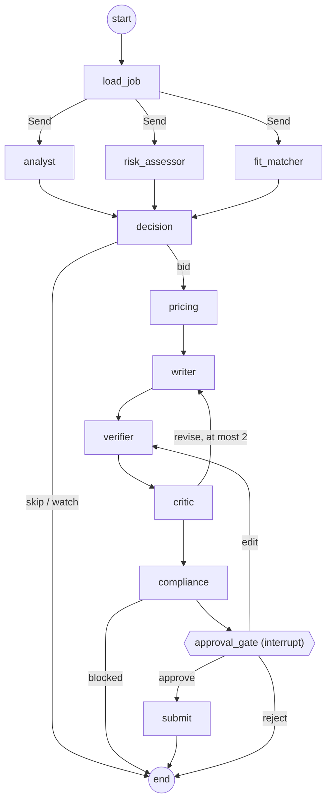

# Architecture

GigBid is a set of agents in two LangGraph graphs. Every capability is an MCP tool behind three
servers we wrote. Everything a client sees passes through a human approval step.

```
Web app (React)  ──►  API (FastAPI)  ──►  Runtime (agent/runtime.py) ──► bid graph / conversation graph
                                               │  checkpoints (Postgres or SQLite)
                                               │  long-term memory store (style + outcomes)
                                               ▼
                      Toolbox (agent/mcp_client.py): per-agent allowlists, timeouts, retries, tracing
                         │                    │                         │
                  Portfolio MCP        Marketplace MCP            Workspace MCP
                  (read-only)          (port: GigSim | Upwork)    (calendar + drafts)
```

Both graphs are rendered from code in `docs/images/bid_graph.mmd` and
`docs/images/conversation_graph.mmd` (`python -m agent.graphs.render`).

## Bid graph (one thread per job)



| Node | Why it exists | Model | Tools |
|---|---|---|---|
| `load_job` | The Scout hands in a job id; the graph loads it once through MCP | none | `get_job` |
| Job Analyst | Turns a messy post into a `JobSpec`: requirements, skills, budget, hidden needs | gpt-oss-20b | none |
| Risk Assessor | Catches scams, free-work and off-platform asks, and injected instructions; rates the client | gpt-oss-20b, plus rules and Prompt Guard | `get_client_history` |
| Fit Matcher | Maps each requirement to portfolio evidence (deployed retriever: `combined`, see `rag/variants/README.md`); refuses only when no requirement or skill has any support | cross-encoder (CPU) | `search_evidence`, `get_evidence`, `list_skills` |
| Decision | Bid, watch or skip from config: risk limit, fit thresholds (calibrated by `evals/runners/fit_calibration.py`) and your budget floor. Explainable; hard scam flags can't be overridden | none | none |
| Pricing Strategist | Bid from market percentiles, the client's budget and the user's floor; is the Connects cost worth it? | none | `get_market_stats`, `get_connects_balance`, `get_client_history` |
| Proposal Writer | Cover letter and screening answers, every claim cited to evidence | gpt-oss-120b | evidence passed in by the Fit Matcher |
| Verifier | Splits the draft into claims and removes unsupported ones before the Critic sees it | cross-encoder plus number and skill checks | none |
| Critic | Grounding, personalisation, length, clarity; sends the draft back at most twice | gpt-oss-120b plus rules | none |
| Compliance Guard | Policy pack: rules strip contact details, guarantees and injection canaries, then a model checks the rest; can block | gpt-oss-20b plus rules | none |
| Approval gate | `interrupt()` with the draft, claim evidence, risk, price rationale and the dry-run preview | none | `create_proposal_draft(dry_run=true)` |
| Submit | Executes only what was approved, with idempotency keys derived from the thread id | none | `create_proposal_draft`, `submit_proposal` |

**Why so many rule-based nodes?** Decision, Pricing and the first pass of Compliance are rules.
They must be explainable in the UI, they must not be talked out of a scam by the job post, and
they cost nothing. Models are used where judgement over text is needed. The R&D comparison
(single agent vs supervisor vs this graph) tests whether this split pays off.

## Conversation graph (one thread per client message)

`read` → `intent` → (`slots` if the client asked for an interview) → `draft_reply` → `compliance`
→ `approval` (interrupt) → `send`, plus a tentative calendar hold for interviews.

Scam signals in a conversation (moving off the platform, asking for free work) get a polite
on-platform refusal drafted for approval. The client's text is wrapped as untrusted data, the same
as job posts.

## State, trace and memory are kept apart

| | What | Where |
|---|---|---|
| State | What this job or conversation needs now: analyses, evidence, decision, price, drafts, critiques, approvals. Reducers are used where parallel branches write (`usage`, `steps`, `errors`, `drafts`). | `agent/state.py`, checkpointed per thread |
| Execution trace | Every LLM and tool call: inputs (PII-masked), output summary, tokens, cost, latency | `agent/trace.py` (SQLite; Langfuse in step 6) |
| Long-term memory | Only promoted knowledge: style rules from edits, outcome lessons per category | `agent/memory/` (LangGraph store) |

Raw tool output never enters memory. The promotion rules are in
`agent/memory/promotion_rules.py`:

- **Style rule.** Promoted when at least 3 of the user's last 10 edits support it and none contradicts it.
- **Outcome lesson.** Promoted when a category has at least 5 resolved proposals and two styles differ in reply rate by at least 15 points.
- **Deleting.** The user can delete either kind from Settings. A deleted style rule is blocked from coming back for 30 days.

## Limits and failure handling

- **Budgets.** Each thread has a step budget (30) and a token budget (40k per job). Exceeding either moves the thread to `needs_attention` instead of letting it loop.
- **Retries.** Every node retries once on transient errors.
- **Fallback model.** Cheap nodes fall back to a second model.
- **Dead letter.** A node that still fails moves the thread to `dead_letter`, with the error kept.
- **Marketplace down.** If the marketplace is unreachable, the thread moves to `degraded`, the UI says "marketplace unavailable", and `Runtime.retry` resumes from the last checkpoint.
- **Rate limits and 5xx.** The adapter retries with backoff and stays under GigSim's rate limit.

## Exactly-once sending

The submit node derives its idempotency keys from the thread id. The Marketplace server stores
results per (user, tool, key), and GigSim enforces keys too. So if the process dies between the
human's approval and the checkpoint after submitting, replaying the thread returns the first
result. It never submits twice or spends Connects twice.

## One marketplace port

`agent/marketplace_port.py` defines the interface. `mcp_servers/marketplace/adapters/` holds the
GigSim adapter and the (not yet built) live Upwork adapter, selected by `marketplace.mode` in
`agent/config.yaml`. The graph only ever calls Marketplace MCP tools, so switching modes changes
configuration, not graph code.

## Configuration, not code

These all live in `agent/config.yaml` and `agent/prompts/*.md` (versioned):

- the model for every node, and both open profiles;
- thresholds, budgets and pricing rules;
- memory promotion rules;
- the retrieval variant;
- all prompts.

Marketplace rules and costs live in `gigsim/policy.yaml`. That way the platform policy change
request is a config and prompt edit.
